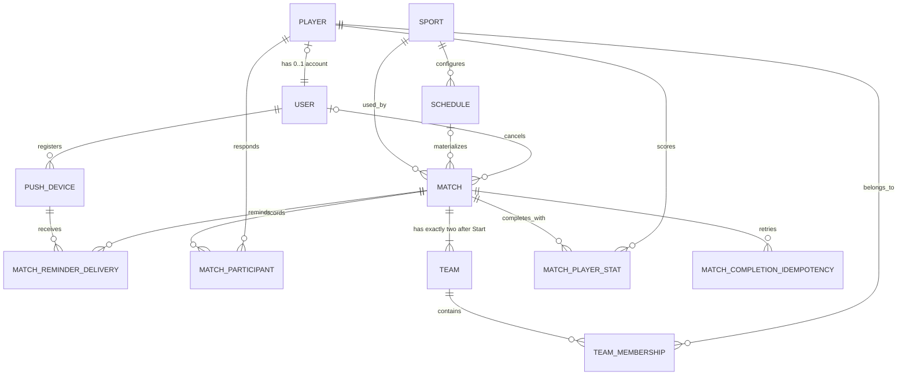

# Teamizer — Database Design

## Scope and conventions

This document is the normative persistence design for the approved MVP. The
Prisma schema and migrations implement it; PostgreSQL-only checks remain listed
explicitly for review.

- PostgreSQL 16+ and Prisma PostgreSQL native types are assumed.
- Primary IDs are UUIDs generated by Prisma. All timestamps are
  `timestamptz(6)` and stored in UTC.
- `Schedule.localStartTime` is a PostgreSQL `time(0)` without a time zone; it
  is interpreted using the schedule's IANA `timeZone` (initially
  `Europe/Prague`).
- The MVP has one implicit group. A `Group` table is deliberately not added:
  every Player, Schedule, and Match belongs to the singleton product group.
  This avoids implementing multi-tenancy before it is needed.
- No `Goal`, scorekeeper, proposal, proposal-history, or derived
  `PlayerStatistics` table exists. `MatchPlayerStats` is the raw, immutable
  aggregate-goals record. Player statistics are derived from finished matches,
  final teams, and these aggregates.

## Enums

| PostgreSQL / Prisma enum | Values | Use |
|---|---|---|
| `UserRole` | `PLAYER`, `ADMIN` | Application authorization |
| `PlayerType` | `REGULAR`, `GUEST` | A guest has no User; conversion changes it to `REGULAR` |
| `PlayerStatus` | `ACTIVE`, `INACTIVE` | New match participation and player actions require `ACTIVE` |
| `MatchStatus` | `OPEN_FOR_REGISTRATION`, `IN_PROGRESS`, `FINISHED`, `CANCELLED` | Persistent lifecycle |
| `Attendance` | `GOING`, `NOT_GOING` | A missing MatchParticipant is unanswered |
| `TeamSide` | `A`, `B` | The two immutable final teams |
| `TeamGenerationMode` | `ALGORITHM`, `MANUAL_ADJUSTMENT`, `MANUAL` | Start-time provenance; `MANUAL` is reserved |
| `Weekday` | `MONDAY` … `SUNDAY` | Recurring schedule configuration |
| `PushProvider` | `EXPO`, `FCM` | Token delivery provider |
| `DevicePlatform` | `IOS`, `ANDROID` | Push-token platform metadata |
| `ReminderType` | `REGISTRATION`, `FINAL` | The configured 48-hour and 3-hour Match reminders |
| `ReminderDeliveryStatus` | `PENDING`, `DELIVERED`, `TRANSIENT_FAILURE`, `INVALID_TOKEN` | Durable per-device delivery state |

## Models and relational rules

### User and Player

`Player` is the permanent sports identity. `User` is the authenticated account
and has a unique foreign key to `Player`, giving **Player 0..1 User**.

The five attribute columns are internal team-balancing inputs, not profile
fields. They deliberately remain on `Player`: access control belongs at the
API/DTO boundary, not in a second persistence model. The MVP has no
per-attribute or configurable visibility setting. API serializers expose them
only to an ADMIN; a normal PLAYER receives no attribute values, including for
their own Player. This leaves a future visibility policy as a serializer and
authorization change without changing the underlying historical Player data.

| Model | Required fields and rules | Keys and indexes | Delete / update behavior |
|---|---|---|---|
| `Player` | UUID ID; name; type; status; five required 1–10 attributes; optional avatar storage metadata; timestamps | PK `id`; index `(status, name)` | A Player is never hard-deleted through MVP flows. Foreign references restrict deletion, preserving history. |
| `User` | UUID ID; `playerId`; unique Firebase `authProviderId`; role default `PLAYER`; notification preference; timestamps | PK `id`; unique `playerId`; unique `authProviderId` | Deleting a User does not delete a Player. User deletion is outside MVP; the Player FK restricts deletion of the Player. |

Guest conversion is one transaction: create the User with the existing
`playerId`, set `Player.type = REGULAR`, and retain every existing foreign key
to that Player. Only an ADMIN performs it. Initial ADMIN provisioning is
outside the database/API flow, as specified.

Avatar binary data is not stored in PostgreSQL. `avatarStorageKey` is an opaque
object-storage key; the API may derive a short-lived `avatarUrl` from it.

### Sport, Schedule, and Match

| Model | Required fields and rules | Keys and indexes | Delete / update behavior |
|---|---|---|---|
| `Sport` | name; `teamsPerMatch`; `playersOnFieldPerTeam`; timestamps | PK `id`; unique `name` | Restrict deletion while a Schedule or Match references it. MVP services accept only `teamsPerMatch = 2`. |
| `Schedule` | weekday; local time; IANA timezone; enabled; sport; optional location; 7-day generation horizon; reminder timings; timestamps | PK `id`; index `(enabled, weekday)` | A schedule can be disabled. If removed administratively, existing Match rows retain history with `scheduleId` set null. |
| `Match` | sport; optional originating schedule; UTC start time; optional location; lifecycle status; final scores only after completion; start/completion/cancellation timestamps; generation provenance/version; monotonic `stateVersion`; timestamps | PK `id`; unique `(scheduleId, startsAt)`; indexes `(status, startsAt)`, `(sportId, startsAt)`, `(scheduleId, startsAt)` | No normal hard delete. Historical children restrict deletion. No global constraint limits IN_PROGRESS matches. |

`stateVersion` is incremented on every Match-affecting persistent mutation:
attendance changes, Start, completion, and cancellation. It is an observable
concurrency token and an audit aid; row locking remains the primary
transactional mechanism.

### Attendance and final teams

| Model | Required fields and rules | Keys and indexes | Delete / update behavior |
|---|---|---|---|
| `MatchParticipant` | match, player, attendance, created/updated timestamps | composite PK `(matchId, playerId)`; index `(matchId, attendance)`; index `(playerId, matchId)` | Restrict deletion of referenced Match/Player. Removing this row while OPEN represents unanswered; it is never removed after Start. |
| `Team` | match, stable side `A` or `B`, created timestamp | PK `id`; unique `(matchId, side)`; unique `(id, matchId)` for the composite membership FK | Restrict deletion when memberships exist. Start creates exactly two rows in one transaction. |
| `TeamMembership` | match, team, player, created timestamp | composite PK `(matchId, playerId)`; index `(teamId, matchId)` | Its PK enforces a player in at most one final team per Match. Composite FK `(teamId, matchId)` proves the Team belongs to the same Match. Immutable after Start. |

There is intentionally no persistent proposed-team model. The backend only
creates `Team` and `TeamMembership` rows after a successful Start transaction.

### Completion and aggregate goals

| Model | Required fields and rules | Keys and indexes | Delete / update behavior |
|---|---|---|---|
| `MatchPlayerStat` | match, player, non-negative aggregate goals, created timestamp | composite PK `(matchId, playerId)`; index `(playerId, matchId)` | Created only by successful completion. Immutable thereafter. |
| `MatchCompletionIdempotency` | match, idempotency key, canonical request SHA-256 hash, creation timestamp | composite PK `(matchId, idempotencyKey)`; index `createdAt` | Created in the completion transaction and retained for the life of the Match. It is not a score event or a lock owner. |

At completion the service normalizes omitted final-team players to zero goals
and writes a `MatchPlayerStat` row for **every final TeamMembership**. This
makes zero goals explicit in history while honoring the API rule that omitted
request entries mean zero. It also rejects a player-goal entry for anybody not
on a final team.

### Push devices and notification preference

`User.notificationsEnabled` is the MVP user-wide preference. `PushDevice`
stores a revocable token registered by that User. Registration of an already
known `(provider, token)` moves/refreshes the token for its authenticated User;
tokens are never treated as an authentication credential.

`MatchReminderDelivery` is the durable delivery claim. Its composite key means
that a Match/reminder/device combination has one durable state even when
scheduler workers race. A per-attempt `claimToken` fences late worker results.
An expired `PENDING` lease or explicit `TRANSIENT_FAILURE` may be reclaimed; a
delivered or invalid-token row is terminal.

| Model | Required fields and rules | Keys and indexes | Delete / update behavior |
|---|---|---|---|
| `PushDevice` | user, provider, platform, push token, active flag, last-seen timestamp, optional invalidation timestamp and device label; timestamps | PK `id`; unique `(provider, pushToken)`; index `(userId, isActive)` | User deletion cascades to its device registrations. Invalidating a token sets it inactive; normal flows do not delete the historical User/Player. |
| `MatchReminderDelivery` | match, push device, reminder type, delivery status, nullable claim token, attempt count, optional attempt/delivery/error data; timestamps | composite PK `(matchId, pushDeviceId, reminderType)`; indexes `(status, lastAttemptAt)` and `(pushDeviceId, createdAt)` | Match and device deletion are restricted. Rows survive worker restarts and are retained with Match history. |

## PostgreSQL invariants beyond Prisma

Prisma does not express all PostgreSQL `CHECK` constraints. The migrations add
the following named constraints:

| Constraint | Rule |
|---|---|
| `player_attributes_range` | Each Player attribute is between 1 and 10 inclusive. |
| `sport_team_shape_positive` | `teams_per_match >= 2` and `players_on_field_per_team >= 1`. |
| `schedule_positive_intervals` | generation horizon and reminder minute values are non-negative; horizon is positive. |
| `match_scores_non_negative` | Each non-null final score is `>= 0`. |
| `match_scores_both_or_neither` | Team A and Team B scores are both null or both non-null. |
| `match_finished_has_result` | A FINISHED match has both scores and `completed_at`; other states cannot have a completion timestamp. |
| `match_player_stats_non_negative` | `goals >= 0`. |
| `match_reminder_attempts_non_negative` | reminder delivery attempt count is `>= 0`. |

The following business invariants span rows and are enforced by the Start and
Complete transactions rather than triggers:

- Start only creates two non-empty Teams, assigns every GOING player exactly
  once, and changes OPEN to IN_PROGRESS atomically.
- Completed goals sum to final Team A plus Team B score.
- A completed match has one stat row for every final team member.
- Attendance and final-team rows do not change after Start; finished results do
  not change after completion.

## Field catalog

The Prisma schema below is normative. This catalog makes the PostgreSQL and
Prisma mapping explicit; relation fields are documented in the model tables
above and appear in the schema.

### `Player`

| Field | PostgreSQL | Prisma | Null / default |
|---|---|---|---|
| `id` | `uuid` | `String @db.Uuid` | PK, `uuid()` |
| `name` | `varchar(120)` | `String @db.VarChar(120)` | required |
| `type` / `status` | enum | `PlayerType` / `PlayerStatus` | required / `ACTIVE` |
| attributes | five `smallint` columns | five `Int @db.SmallInt` fields | required internal balancing inputs; DB check 1–10; never exposed in ordinary PLAYER read DTOs |
| avatar fields | `varchar(512)`, `varchar(100)`, `timestamptz(6)` | nullable `String`, `String`, `DateTime` | null when no avatar |
| timestamps | `timestamptz(6)` | `DateTime` | `createdAt` now; `updatedAt` automatic |

### `User`

| Field | PostgreSQL | Prisma | Null / default |
|---|---|---|---|
| `id`, `player_id` | `uuid` | `String @db.Uuid` | PK; required unique FK |
| `auth_provider_id` | `varchar(255)` | `String @db.VarChar(255)` | required unique Firebase UID |
| `role` | enum | `UserRole` | `PLAYER` |
| `notifications_enabled` | `boolean` | `Boolean` | `true` |
| timestamps | `timestamptz(6)` | `DateTime` | now / automatic |

### `Sport` and `Schedule`

| Model / field | PostgreSQL | Prisma | Null / default |
|---|---|---|---|
| `Sport.id` | `uuid` | `String @db.Uuid` | PK, `uuid()` |
| `Sport.name` | `varchar(80)` | `String @db.VarChar(80)` | required unique |
| Sport counts | `smallint` | `Int @db.SmallInt` | required; positive DB check |
| `Schedule.id`, `sport_id` | `uuid` | `String @db.Uuid` | PK; required FK |
| weekday | enum | `Weekday` | `TUESDAY` |
| local time / timezone | `time(0)`, `varchar(64)` | `DateTime @db.Time(0)`, `String` | required / `Europe/Prague` |
| enabled | `boolean` | `Boolean` | `true` |
| location | `varchar(255)` | nullable `String` | null allowed |
| horizon/reminders | `integer` | `Int` | 7 / 2880 / 180; checked |
| timestamps | `timestamptz(6)` | `DateTime` | now / automatic |

### `Match`

| Field | PostgreSQL | Prisma | Null / default |
|---|---|---|---|
| IDs (`id`, `schedule_id`, `sport_id`, `cancelled_by_user_id`) | `uuid` | `String @db.Uuid` | PK; schedule/canceller nullable, sport required |
| `starts_at`, lifecycle timestamps | `timestamptz(6)` | `DateTime @db.Timestamptz(6)` | `startsAt` required; terminal timestamps nullable |
| location | `varchar(255)` | nullable `String` | null allowed |
| status | enum | `MatchStatus` | `OPEN_FOR_REGISTRATION` |
| team scores | `integer` | nullable `Int` | null until completion; non-negative checks |
| provenance versions | enum plus `varchar(64)` | nullable `TeamGenerationMode`, `String` | null until Start |
| `state_version` | `integer` | `Int` | `0`; incremented by match writes |
| timestamps | `timestamptz(6)` | `DateTime` | now / automatic |

### Child and support models

| Model | PostgreSQL fields | Prisma key/type summary | Null / default |
|---|---|---|---|
| `MatchParticipant` | `match_id uuid`, `player_id uuid`, attendance enum, timestamps | `@@id([matchId, playerId])`; `Attendance` | attendance required |
| `Team` | `id uuid`, `match_id uuid`, side enum, `created_at` | UUID PK; unique `(matchId, side)` and `(id, matchId)` | all required |
| `TeamMembership` | `match_id uuid`, `player_id uuid`, `team_id uuid`, `created_at` | `@@id([matchId, playerId])`; composite FK to Team | all required |
| `MatchPlayerStat` | `match_id uuid`, `player_id uuid`, `goals integer`, `created_at` | `@@id([matchId, playerId])` | goals required, `>= 0` |
| `MatchCompletionIdempotency` | `match_id uuid`, `idempotency_key varchar(255)`, `request_hash char(64)`, timestamp | `@@id([matchId, idempotencyKey])` | all required |
| `PushDevice` | UUID IDs/FK, provider/platform enums, `push_token text`, boolean, nullable invalidation and label, timestamps | UUID PK; unique `(provider, pushToken)` | active true; invalidation null |
| `MatchReminderDelivery` | Match/device UUID FKs, reminder/status enums, nullable claim UUID, attempt count, nullable attempt/delivery/error data, timestamps | `@@id([matchId, pushDeviceId, reminderType])` | status `PENDING`; attempts 0; optional fields null |

## ER diagram



## Proposed Prisma schema

The following is the normative Prisma schema. The PostgreSQL checks above are
added by migrations because Prisma has no native
`@@check` declaration.

```prisma
generator client {
  provider = "prisma-client-js"
}

datasource db {
  provider = "postgresql"
  url      = env("DATABASE_URL")
}

enum UserRole {
  PLAYER
  ADMIN
}

enum PlayerType {
  REGULAR
  GUEST
}

enum PlayerStatus {
  ACTIVE
  INACTIVE
}

enum MatchStatus {
  OPEN_FOR_REGISTRATION
  IN_PROGRESS
  FINISHED
  CANCELLED
}

enum Attendance {
  GOING
  NOT_GOING
}

enum TeamSide {
  A
  B
}

enum TeamGenerationMode {
  ALGORITHM
  MANUAL_ADJUSTMENT
  MANUAL
}

enum Weekday {
  MONDAY
  TUESDAY
  WEDNESDAY
  THURSDAY
  FRIDAY
  SATURDAY
  SUNDAY
}

enum PushProvider {
  EXPO
  FCM
}

enum DevicePlatform {
  IOS
  ANDROID
}

enum ReminderType {
  REGISTRATION
  FINAL
}

enum ReminderDeliveryStatus {
  PENDING
  DELIVERED
  TRANSIENT_FAILURE
  INVALID_TOKEN
}

model User {
  id                   String       @id @default(uuid()) @db.Uuid
  playerId             String       @unique @db.Uuid
  authProviderId       String       @unique @db.VarChar(255)
  role                 UserRole     @default(PLAYER)
  notificationsEnabled Boolean      @default(true)
  createdAt            DateTime     @default(now()) @db.Timestamptz(6)
  updatedAt            DateTime     @updatedAt @db.Timestamptz(6)

  player            Player       @relation("PlayerUser", fields: [playerId], references: [id], onDelete: Restrict, onUpdate: Cascade)
  pushDevices       PushDevice[]
  cancelledMatches  Match[]      @relation("CancelledBy")
}

model Player {
  id                 String        @id @default(uuid()) @db.Uuid
  name               String        @db.VarChar(120)
  type               PlayerType
  status             PlayerStatus  @default(ACTIVE)
  speed              Int           @db.SmallInt
  endurance          Int           @db.SmallInt
  defense            Int           @db.SmallInt
  attack             Int           @db.SmallInt
  technique          Int           @db.SmallInt
  avatarStorageKey   String?       @db.VarChar(512)
  avatarContentType  String?       @db.VarChar(100)
  avatarUpdatedAt    DateTime?     @db.Timestamptz(6)
  createdAt          DateTime      @default(now()) @db.Timestamptz(6)
  updatedAt          DateTime      @updatedAt @db.Timestamptz(6)

  user               User?              @relation("PlayerUser")
  participants       MatchParticipant[]
  teamMemberships    TeamMembership[]
  matchPlayerStats   MatchPlayerStat[]

  @@index([status, name])
}

model Sport {
  id                     String     @id @default(uuid()) @db.Uuid
  name                   String     @unique @db.VarChar(80)
  teamsPerMatch          Int        @db.SmallInt
  playersOnFieldPerTeam  Int        @db.SmallInt
  createdAt              DateTime   @default(now()) @db.Timestamptz(6)
  updatedAt              DateTime   @updatedAt @db.Timestamptz(6)

  schedules              Schedule[]
  matches                Match[]
}

model Schedule {
  id                         String    @id @default(uuid()) @db.Uuid
  weekday                    Weekday   @default(TUESDAY)
  localStartTime             DateTime  @db.Time(0)
  timeZone                   String    @default("Europe/Prague") @db.VarChar(64)
  enabled                    Boolean   @default(true)
  sportId                    String    @db.Uuid
  location                   String?   @db.VarChar(255)
  generationHorizonDays      Int       @default(7)
  registrationReminderMinutes Int      @default(2880)
  finalReminderMinutes       Int       @default(180)
  createdAt                  DateTime  @default(now()) @db.Timestamptz(6)
  updatedAt                  DateTime  @updatedAt @db.Timestamptz(6)

  sport                      Sport     @relation(fields: [sportId], references: [id], onDelete: Restrict, onUpdate: Cascade)
  matches                    Match[]

  @@index([enabled, weekday])
}

model Match {
  id                       String              @id @default(uuid()) @db.Uuid
  scheduleId               String?             @db.Uuid
  sportId                  String              @db.Uuid
  startsAt                 DateTime            @db.Timestamptz(6)
  location                 String?             @db.VarChar(255)
  status                   MatchStatus         @default(OPEN_FOR_REGISTRATION)
  teamAScore               Int?
  teamBScore               Int?
  startedAt                DateTime?           @db.Timestamptz(6)
  completedAt              DateTime?           @db.Timestamptz(6)
  cancelledAt              DateTime?           @db.Timestamptz(6)
  cancelledByUserId        String?             @db.Uuid
  teamGenerationMode       TeamGenerationMode?
  algorithmVersion         String?             @db.VarChar(64)
  configurationVersion     String?             @db.VarChar(64)
  stateVersion             Int                 @default(0)
  createdAt                DateTime            @default(now()) @db.Timestamptz(6)
  updatedAt                DateTime            @updatedAt @db.Timestamptz(6)

  schedule                 Schedule?           @relation(fields: [scheduleId], references: [id], onDelete: SetNull, onUpdate: Cascade)
  sport                    Sport               @relation(fields: [sportId], references: [id], onDelete: Restrict, onUpdate: Cascade)
  cancelledBy              User?               @relation("CancelledBy", fields: [cancelledByUserId], references: [id], onDelete: SetNull, onUpdate: Cascade)
  participants             MatchParticipant[]
  teams                    Team[]
  matchPlayerStats         MatchPlayerStat[]
  completionIdempotencies  MatchCompletionIdempotency[]
  reminderDeliveries       MatchReminderDelivery[]

  @@unique([scheduleId, startsAt])
  @@index([status, startsAt])
  @@index([sportId, startsAt])
  @@index([scheduleId, startsAt])
}

model MatchParticipant {
  matchId     String      @db.Uuid
  playerId    String      @db.Uuid
  attendance  Attendance
  createdAt   DateTime    @default(now()) @db.Timestamptz(6)
  updatedAt   DateTime    @updatedAt @db.Timestamptz(6)

  match       Match       @relation(fields: [matchId], references: [id], onDelete: Restrict, onUpdate: Cascade)
  player      Player      @relation(fields: [playerId], references: [id], onDelete: Restrict, onUpdate: Cascade)

  @@id([matchId, playerId])
  @@index([matchId, attendance])
  @@index([playerId, matchId])
}

model Team {
  id           String            @id @default(uuid()) @db.Uuid
  matchId      String            @db.Uuid
  side         TeamSide
  createdAt    DateTime          @default(now()) @db.Timestamptz(6)

  match        Match             @relation(fields: [matchId], references: [id], onDelete: Restrict, onUpdate: Cascade)
  memberships  TeamMembership[]

  @@unique([matchId, side])
  @@unique([id, matchId])
}

model TeamMembership {
  matchId    String    @db.Uuid
  playerId   String    @db.Uuid
  teamId     String    @db.Uuid
  createdAt  DateTime  @default(now()) @db.Timestamptz(6)

  player     Player    @relation(fields: [playerId], references: [id], onDelete: Restrict, onUpdate: Cascade)
  team       Team      @relation(fields: [teamId, matchId], references: [id, matchId], onDelete: Restrict, onUpdate: Cascade)

  @@id([matchId, playerId])
  @@index([teamId, matchId])
}

model MatchPlayerStat {
  matchId    String    @db.Uuid
  playerId   String    @db.Uuid
  goals      Int
  createdAt  DateTime  @default(now()) @db.Timestamptz(6)

  match      Match     @relation(fields: [matchId], references: [id], onDelete: Restrict, onUpdate: Cascade)
  player     Player    @relation(fields: [playerId], references: [id], onDelete: Restrict, onUpdate: Cascade)

  @@id([matchId, playerId])
  @@index([playerId, matchId])
}

model MatchCompletionIdempotency {
  matchId         String    @db.Uuid
  idempotencyKey  String    @db.VarChar(255)
  requestHash     String    @db.Char(64)
  createdAt       DateTime  @default(now()) @db.Timestamptz(6)

  match           Match     @relation(fields: [matchId], references: [id], onDelete: Restrict, onUpdate: Cascade)

  @@id([matchId, idempotencyKey])
  @@index([createdAt])
}

model PushDevice {
  id             String          @id @default(uuid()) @db.Uuid
  userId         String          @db.Uuid
  provider       PushProvider
  platform       DevicePlatform
  pushToken      String          @db.Text
  isActive       Boolean         @default(true)
  invalidatedAt  DateTime?       @db.Timestamptz(6)
  lastSeenAt     DateTime        @default(now()) @db.Timestamptz(6)
  deviceLabel    String?         @db.VarChar(120)
  createdAt      DateTime        @default(now()) @db.Timestamptz(6)
  updatedAt      DateTime        @updatedAt @db.Timestamptz(6)

  user           User            @relation(fields: [userId], references: [id], onDelete: Cascade, onUpdate: Cascade)
  reminderDeliveries MatchReminderDelivery[]

  @@unique([provider, pushToken])
  @@index([userId, isActive])
}

model MatchReminderDelivery {
  matchId       String                 @db.Uuid
  pushDeviceId  String                 @db.Uuid
  reminderType  ReminderType
  status        ReminderDeliveryStatus @default(PENDING)
  claimToken    String?                @db.Uuid
  attemptCount  Int                    @default(0)
  lastAttemptAt DateTime?              @db.Timestamptz(6)
  deliveredAt   DateTime?              @db.Timestamptz(6)
  errorCode     String?                @db.VarChar(64)
  createdAt     DateTime               @default(now()) @db.Timestamptz(6)
  updatedAt     DateTime               @updatedAt @db.Timestamptz(6)

  match      Match      @relation(fields: [matchId], references: [id], onDelete: Restrict, onUpdate: Cascade)
  pushDevice PushDevice @relation(fields: [pushDeviceId], references: [id], onDelete: Restrict, onUpdate: Cascade)

  @@id([matchId, pushDeviceId, reminderType])
  @@index([status, lastAttemptAt])
  @@index([pushDeviceId, createdAt])
}
```

## Design review

- Guests are Players without Users; conversion preserves every Player foreign
  key because Player IDs never change.
- Unanswered attendance is represented by the absence of a composite-keyed
  MatchParticipant row.
- The TeamMembership composite primary key enforces one final team per player
  per match and the composite Team FK prevents cross-match membership.
- Team, TeamMembership, MatchPlayerStat, and final score rows are only written
  by lifecycle transactions. No mutation endpoint is designed for FINISHED.
- Start serializes Player activity with administration by locking the Match
  first and then all GOING Player rows in UUID order before its ACTIVE check;
  this is a transaction rule, not an additional schema constraint.
- No table stores live score, scoring ownership, proposed alternatives, or goal
  events.
- `(matchId, idempotencyKey)` makes a completion retry distinguishable from a
  second device's different completion request.
- Indexes serve the primary attendance, upcoming-match, historical-statistics,
  and active-device queries without adding speculative structures.
- Balancing attributes remain required Player columns for the algorithm, but
  only ADMIN serializers include them. No attribute visibility setting is
  persisted, and all PLAYER read DTOs omit them, including for self.
